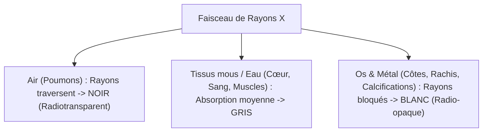
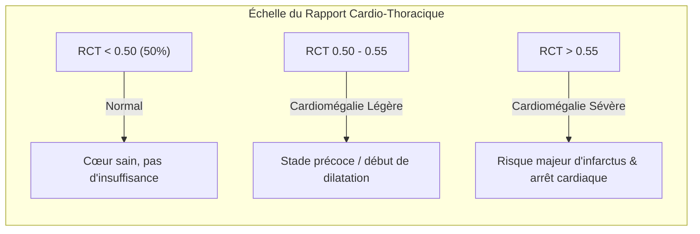
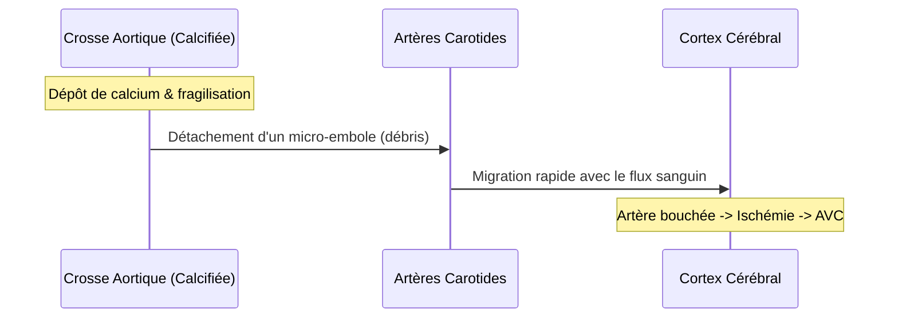
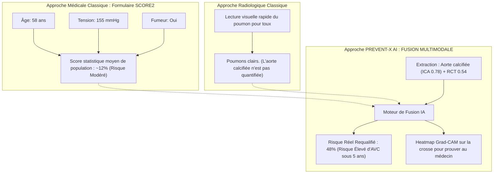

# 🩺 Cours Médical Approfondi : Physiopathologie, Imagerie & Prédicteurs Cliniques

Ce guide pose les **fondations scientifiques et médicales strictes** de **PREVENT-X AI**. Il détaille ce qui se passe physiologiquement dans le corps humain, ce qui est visible sur une radiographie ou une IRM, et pourquoi notre modèle croise ces données.

---

## 🫀 Chapitre 1 : Anatomie Thoracique & Projection Radiologique

Pour comprendre une radio du thorax (projection postéro-antérieure PA), il faut visualiser la cage thoracique comme une superposition de densités :



### Les 3 Repères Anatomiques Vitaux de notre IA :

```
                  [ Clavicule Droite ]           [ Clavicule Gauche ]
                                   \               /
                                    [ Trachée ]
                                        |
               ========================[ CROSSE AORTIQUE ] <--- (1) Risque AVC
              |                         (Bouton aortique)|
    [ Poumon Droit ]                     \               |   [ Poumon Gauche ]
      (Noir / Air)                        [ Tronc Pulm ] |      (Noir / Air)
                                                \        |
                                       [ Oreillette G. ] |
    [ Oreillette Droite ]                        \       |
              \                                   [ VENTRICULE GAUCHE ] <--- (2) Risque Cardiaque
               \                                  /    (Apex Cardiaque)
        ~~~~~~~~~~~~~~~~~~~~~~~~~~~~~~~~~~~~~~~~~~
        [ DIAPHRAGME D. ]            [ DIAPHRAGME G. ]
                               |
                [ COLONNE VERTÉBRALE (RACHIS DORSAL) ] <--- (3) Risque Osseux
```

1. **La Crosse Aortique (Arcus Aortae) :** L'artère géante qui éjecte le sang du cœur vers le cerveau et le reste du corps. Sur la radio, elle forme un contour arrondi bien visible en haut à gauche du cœur : le **bouton aortique**.
2. **Le Ventricule Gauche (Apex cardiaque) :** La pompe musculaire principale. C'est elle qui détermine le volume de la silhouette cardiaque.
3. **Le Rachis Dorsal (Vertèbres T1 à T12) :** L'armature osseuse axiale en arrière-plan au centre.

---

## 💔 Chapitre 2 : Physiopathologie du Risque Cardiaque (Infarctus & Insuffisance)

### 1. Que se passe-t-il dans le corps ?
L'ennemi silencieux numéro un est l'**athérosclérose** combinée à l'**hypertension artérielle** :
- **Excès de cholestérol LDL + Tabac** $\rightarrow$ Création de plaques lipidiques molles dans les parois des artères coronaires (celles qui nourrissent le myocarde).
- **Hypertension artérielle permanente ($> 140$ mmHg)** $\rightarrow$ Le cœur doit forcer à chaque battement pour éjecter le sang contre une pression trop haute.
- **Le phénomène du bodybuilder** : Tout muscle qui force grossit. Le muscle cardiaque s'épaissit d'abord (hypertrophie ventriculaire gauche), puis s'épuise, se détend et se dilate : c'est la **cardiomégalie**.

### 2. Ce qu'on observe sur la radio : Le Rapport Cardio-Thoracique (RCT)
En radiologie, le volume cardiaque ne se mesure pas en centimètres absolus (car cela dépend de la taille de la personne), mais en **proportion par rapport à la cage thoracique** :

$$RCT = \frac{\text{Diamètre Transverse Maximal du Cœur}}{\text{Diamètre Transverse Maximal du Thorax}}$$



> [!IMPORTANT]
> Un RCT $> 0.52$ chez un patient hypertendu est l'un des signaux d'alerte les plus fiables d'accident cardiaque décompensé dans les 5 ans.

---

## 🧠 Chapitre 3 : Physiopathologie du Risque d'AVC (Accident Vasculaire Cérébral)

### 1. D'où vient un AVC ischémique ?
Dans 85% des cas, un AVC est provoqué par l'obstruction d'une artère cérébrale par un **caillot** ou un **débris de plaque d'athérome**.

### 2. Pourquoi la Crosse Aortique est le point critique ?
Regardez l'arbre vasculaire :
- Du sommet de la crosse aortique partent directement les **artères carotides** (droite et gauche).
- Les carotides montent dans le cou et irriguent directement le cerveau.
- Si la crosse aortique est saine, ses parois sont élastiques, souples et invisibles en radiographie.
- Si le patient fume ou a du cholestérol depuis 15 ans : du calcium précipite dans les plaques. La paroi de l'aorte devient rigide et cassante : c'est la **calcification de l'arche aortique**.
- **Le mécanisme de l'accident :** Le flux sanguin turbulent arrache des micro-fragments calcifiés de la crosse aortique. Ces fragments montent à toute vitesse dans les carotides et bouchent une artériole du cerveau $\rightarrow$ **AVC instantané**.



### 3. Ce que l'œil humain et l'IA voient : L'Indice de Calcification Aortique (ICA)
Sur la radio, une crosse calcifiée n'est plus grise translucide : elle présente un **arc blanc opaque très net** (le "bouton aortique en coquille d'œuf").

---

## 🦴 Chapitre 4 : Physiopathologie du Risque Osseux (Ostéoporose & Tassements)

### 1. Pourquoi analyser les os sur une radio du cœur/poumons ?
C'est le principe du **dépistage opportuniste** (*opportunistic screening*) :
- La plupart des gens ne font jamais d'ostéodensitométrie (DEXA) avant d'avoir une fracture grave du col du fémur (qui entraîne 20% de décès chez les personnes âgées dans l'année).
- Mais ils font des radios thoraciques régulières ! Et sur cette radio, les vertèbres dorsales sont là, bien visibles.

### 2. Le mécanisme de l'ostéopénie et du tassement :
- Avec l'âge et la ménopause, l'os perd sa trame calcaire (ostéopénie $\rightarrow$ ostéoporose).
- Sur la radiographie, les vertèbres normales sont claires et régulières. Les vertèbres ostéoporotiques deviennent **noires / transparentes** (les rayons X traversent sans résistance).
- Sous le poids de la colonne, la vertèbre fragilisée s'écrase sur elle-même : c'est le **tassement vertébral**.
- **Règle clinique d'or :** Un micro-tassement vertébral non diagnostiqué multiplie par **5** le risque de fracture du fémur dans les 3 ans.

---

## 🔬 Chapitre 5 : Le Croisement Multimodal (Pourquoi l'IA dépasse la médecine classique)

C'est ici que se trouve le **cœur scientifique de PREVENT-X AI** :



### Le diagnostic croisé :
- Deux personnes ont exactement le même âge (58 ans) et la même tension (155 mmHg) :
  - **Patient A :** Sa radio montre une aorte souple et un RCT normal ($0.45$) $\rightarrow$ Risque réel maîtrisé ($14\%$).
  - **Patient B :** Sa radio montre une crosse aortique calcifiée (ICA $0.78$) et un ventricule gauche épaissi ($0.54$) $\rightarrow$ **Risque réel critique ($48\%$) : l'accident vasculaire est imminent sans traitement préventif.**

---

## 🎯 Chapitre 6 : Les 4 Priorités Absolues de notre Projet

Pour que vous sachiez exactement sur quoi vous concentrer au quotidien :

| Priorité | Cible Anatomique | Ce qu'on analyse | Valeur Normale | Valeur d'Alerte |
| :--- | :--- | :--- | :--- | :--- |
| **P1. Risque Cardiaque** | Silhouette cardiaque & Apex | **Rapport Cardio-Thoracique (RCT)** | $< 0.50$ | $> 0.52$ (Cardiomégalie) |
| **P2. Risque AVC** | Bouton & Crosse Aortique | **Indice Calcification Aortique (ICA)** | $< 0.35$ | $> 0.60$ (Plaques denses) |
| **P3. Risque Osseux** | Vertèbres thoraciques | **Hauteur & Densité rachidienne** | Corps rectangulaires | Perte de hauteur (tassement) |
| **P4. Explicabilité** | Carte Grad-CAM | **Heatmap rouge/jaune** | Répartition diffuse | Pic d'attention sur l'aorte ou le cœur |
