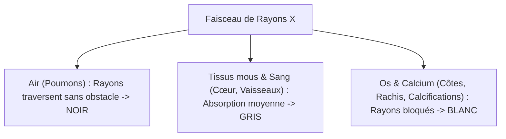
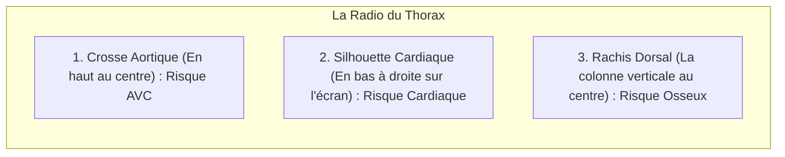
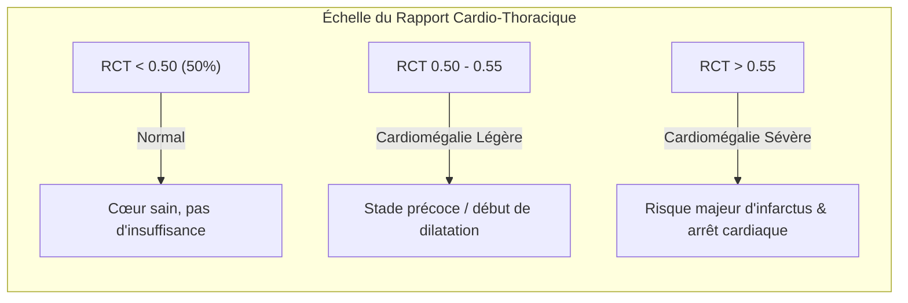
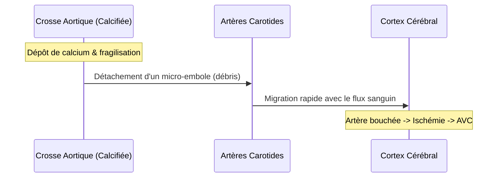

# 🩺 Cours Médical Approfondi : Physiopathologie, Imagerie & Prédicteurs Cliniques

Ce guide pose les **fondations scientifiques et médicales strictes** de **PREVENT-X AI**. Il détaille ce qui se passe physiologiquement dans le corps humain, ce qui est visible sur une radiographie ou une IRM, et pourquoi notre modèle croise ces données.

---

## 🫀 Chapitre 1 : Anatomie Thoracique & Projection Radiologique

### 1. La règle d'or de la lecture radiologique : « La poignée de main »
Quand vous regardez une radiographie du thorax de face, **vous êtes face au patient, comme si vous lui serriez la main** :
- La droite du patient se trouve à **votre gauche**.
- La gauche du patient se trouve à **votre droite**.
- Le cœur est situé au milieu, mais sa grosse pointe (le ventricule gauche) penche vers la gauche du patient (donc vers **votre droite**).

### 2. Comment la radio se forme (Les 3 couleurs) :


---

### 3. Schéma Visuel Annoté : Les 3 Zones Clés de notre IA

Voici exactement comment ces 3 zones se présentent sur une véritable radiographie :




---

## 💔 Chapitre 2 : Physiopathologie du Risque Cardiaque (Infarctus & Insuffisance)

### 1. Que se passe-t-il dans le corps ?
L'ennemi silencieux numéro un est l'**athérosclérose** combinée à l'**hypertension artérielle** :
- **Excès de cholestérol LDL + Tabac** $\rightarrow$ Création de plaques lipidiques molles dans les parois des artères coronaires (celles qui nourrissent le muscle du cœur).
- **Hypertension artérielle permanente ($> 140$ mmHg)** $\rightarrow$ Le cœur doit forcer à chaque battement pour éjecter le sang contre une pression trop haute dans les tuyaux.
- **Le phénomène du bodybuilder** : Tout muscle qui force grossit. Le muscle cardiaque s'épaissit d'abord (hypertrophie), puis s'épuise, se détend et se dilate : c'est la **cardiomégalie**.

### 2. Ce qu'on observe sur la radio : Le Rapport Cardio-Thoracique (RCT)
En radiologie, le volume cardiaque se mesure en **proportion par rapport à la largeur totale de la cage thoracique** :

$$RCT = \frac{\text{Largeur Maximale du Cœur}}{\text{Largeur Maximale de la Cage Thoracique}}$$



> [!IMPORTANT]
> Un RCT $> 0.52$ chez un patient hypertendu est un signal d'alerte clinique majeur : le cœur est en sur-régime permanent.

---

## 🧠 Chapitre 3 : Physiopathologie du Risque d'AVC (Accident Vasculaire Cérébral)

### 1. D'où vient un AVC ischémique ?
Dans 85% des cas, un AVC est provoqué par l'obstruction d'une artère cérébrale par un **caillot** ou un **débris de plaque d'athérome**.

### 2. Pourquoi la Crosse Aortique est le point critique ?
- Du sommet de la crosse aortique partent directement les **artères carotides** qui montent dans le cou irriguer le cerveau.
- Si le patient fume ou a trop de cholestérol depuis des années, du **calcium** précipite dans les parois de l'aorte : elle devient rigide comme un vieux tuyau entartré.
- Avec le flux sanguin puissant expulsé par le cœur, des micro-fragments de calcaire se détachent, sont propulsés dans les carotides et bouchent instantanément une artère du cerveau $\rightarrow$ **AVC**.



### 3. Ce que l'œil humain et l'IA voient : L'Indice de Calcification Aortique (ICA)
Sur la radio, une crosse saine est grise et discrète. Une crosse calcifiée et dangereuse présente un **liseré blanc très opaque et dense** (le "bouton aortique calcifié").

---

## 🦴 Chapitre 4 : Physiopathologie du Risque Osseux (Ostéoporose & Tassements)

### 1. Pourquoi analyser les os sur une radio du cœur/poumons ?
C'est le principe du **dépistage opportuniste** (*opportunistic screening*) :
- Les gens ne font presque jamais de radio des os avant de s'être fracturé le col du fémur (ce qui tue 20% des personnes âgées dans l'année).
- En revanche, ils font souvent des radios du thorax pour une bronchite ou un bilan opératoire. Et au milieu de cette radio, **les vertèbres dorsales sont parfaitement visibles**.

### 2. Le mécanisme du tassement vertébral :
- Avec l'âge, l'os perd son calcium : sur la radio, la vertèbre devient de plus en plus sombre/transparente.
- Fragilisée, elle s'écrase sous le poids du haut du corps : la vertèbre perd de sa hauteur.
- **Règle clinique d'or :** Un micro-tassement vertébral visible sur une radio du thorax multiplie par **5** le risque de fracture grave de la hanche dans les 3 ans.

---

## 🔬 Chapitre 5 : Le Croisement Multimodal (Pourquoi l'IA bat la médecine classique)

```mermaid
graph TD
    subgraph Clinique_Seule [Formulaire Classique (Score SCORE2)]
        C1["Âge: 58 ans"]
        C2["Tension: 155 mmHg"]
        C3["Fumeur: Oui"]
        C1 & C2 & C3 --> C_RES["Score statistique théorique : ~12% (Risque Modéré)"]
    end

    subgraph Imagerie_Seule [Radio Thorax Classique]
        R1["Lecture rapide des poumons"]
        R1 --> R_RES["Poumons clairs. (L'aorte calcifiée n'est pas quantifiée)"]
    end

    subgraph PREVENT_X [PREVENT-X AI : FUSION MULTIMODALE]
        C_RES -.-> FUSION["Moteur de Fusion IA"]
        R_RES -.-> FUSION
        IMG["Extraction : Aorte calcifiée (ICA 0.78) + RCT 0.54"] --> FUSION
        FUSION --> FINAL["Risque Réel Requalifié : 48% (Risque Élevé d'AVC sous 5 ans)"]
        FUSION --> HEATMAP["Heatmap Grad-CAM rouge sur la crosse pour prouver au médecin"]
    end
```

---

## 🎯 Chapitre 6 : Les 4 Priorités Absolues de notre Projet

| Priorité | Cible Anatomique | Ce qu'on analyse | Valeur Normale | Valeur d'Alerte |
| :--- | :--- | :--- | :--- | :--- |
| **P1. Risque Cardiaque** | Silhouette cardiaque & Apex | **Rapport Cardio-Thoracique (RCT)** | $< 0.50$ | $> 0.52$ (Cardiomégalie) |
| **P2. Risque AVC** | Bouton & Crosse Aortique | **Indice Calcification Aortique (ICA)** | $< 0.35$ | $> 0.60$ (Plaques denses) |
| **P3. Risque Osseux** | Vertèbres thoraciques | **Hauteur & Densité rachidienne** | Corps rectangulaires | Perte de hauteur (tassement) |
| **P4. Explicabilité** | Carte Grad-CAM | **Heatmap rouge/jaune** | Répartition diffuse | Pic d'attention sur l'aorte ou le cœur |
