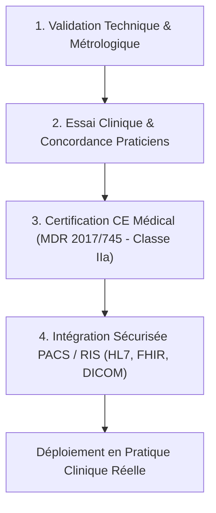
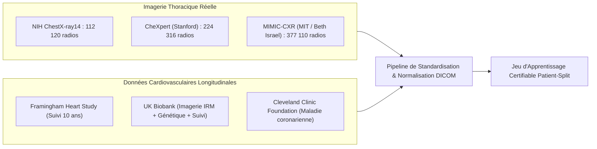
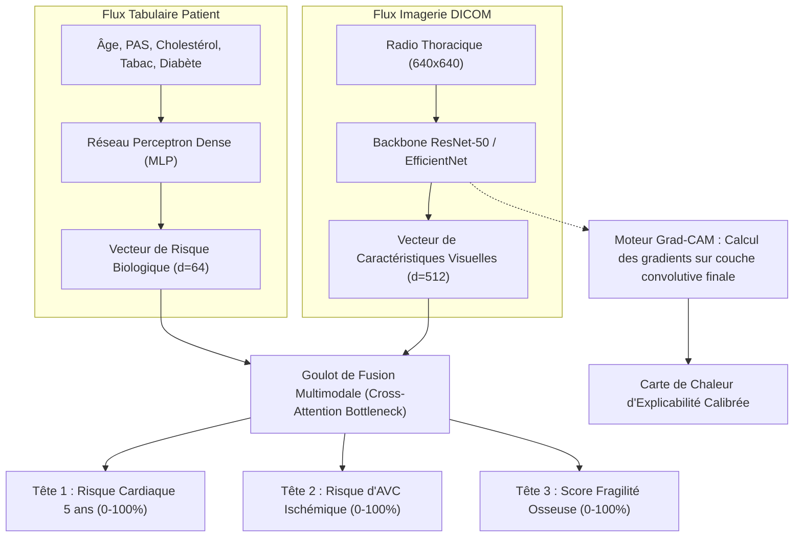

# 🏥 PREVENT-X AI : Dossier d'Ingénierie & Homologation pour Usage Clinique Réel

> **Document de Référence Technique & Réglementaire (SaMD - Software as a Medical Device)**  
> **Cadre :** Directive Européenne MDR 2017/745 (Classe IIa) • ISO 13485 • ISO 14971 • IEC 62304 • RGPD / HDS

---

## 📑 Sommaire
1. [La réalité du déploiement hospitalier : Les 4 barrières infranchissables](#1-les-4-barrières-infranchissables)
2. [Constitution & Validation des Jeux de Données Réels](#2-constitution--validation-des-jeux-de-données-réels)
3. [Architecture de l'IA & Entraînement Multimodal Certifiable](#3-architecture-de-lia--entraînement-multimodal)
4. [Évaluation Clinique & Métriques Médicales Exigibles](#4-évaluation-clinique--métriques-médicales)
5. [Ergonomie Médicale : Les Principes d'une Console Pro Sans Superflu](#5-ergonomie-médicale--console-pro-sans-superflu)
6. [Feuille de Route d'Homologation & Déploiement](#6-feuille-de-route-dhomologation)

---

## 1. Les 4 barrières infranchissables pour être utilisé « pour de vrai »

Pour qu'un cardiologue ou un radiologue ait le droit légal d'utiliser PREVENT-X AI sur un vrai patient, 4 étapes obligatoires s'imposent :



1. **La Qualification Dispositif Médical (MDR 2017/745 - Règle 11)** :
   - Tout logiciel qui fournit des informations utilisées pour prendre des décisions à des fins diagnostiques ou thérapeutiques est classé au minimum en **Classe IIa**.
   - Cela impose un audit complet par un **Organisme Notifié** (ex: GMED, BSI, TÜV).
2. **Le Système de Management de la Qualité (ISO 13485:2016)** :
   - Traçabilité intégrale de chaque ligne de code, de chaque jeu de données d'entraînement, et de chaque commit (norme logicielle **IEC 62304**).
3. **La Gestion des Risques Médicaux (ISO 14971:2019)** :
   - Analyse formelle : *Que se passe-t-il si l'IA produit un faux négatif (ne voit pas une calcification critique) ?*
   - Mise en place de barrières : l'IA ne pose jamais de diagnostic définitif seule, elle est qualifiée d'outil de **CADe/CADx (aide au dépistage et triage)** avec obligation de validation humaine.
4. **Hébergement des Données de Santé (Certifications HDS & RGPD)** :
   - Interdiction formelle d'envoyer des radiographies nominatives sur un cloud public non certifié. L'inférence doit se faire soit **sur site (Edge / serveur PACS local)**, soit sur un cloud certifié HDS avec anonymisation irréversible préalable.

---

## 2. Constitution & Validation des Jeux de Données Réels

Un modèle médical ne peut pas être entraîné sur des données génériques. Il exige des cohortes réelles multicentriques pour éviter le biais d'équipement :



### Règles d'Or du Pipeline de Données :
- **Patient-Level Splitting Stricte** : Si un patient a 3 radios successives dans la cohorte, les 3 radios doivent impérativement être dans le même ensemble (soit Train, soit Test). Mélanger les radios d'un même patient entre Train et Test est une faute méthodologique majeure (data leakage).
- **Standardisation DICOM** :
  - Harmonisation du fenêtrage radiologique (Window Center / Window Width).
  - Compensation de l'espacement des pixels (*Pixel Spacing* en mm/pixel) pour que les mesures millimétriques (diamètre cardiaque) restent exactes quelle que soit la résolution du détecteur.
  - Anonymisation selon le profil **DICOM PS 3.15 Annexe E**.

---

## 3. Architecture de l'IA & Entraînement Multimodal

L'intelligence artificielle repose sur une architecture **hybride certifiable** :



### Fonction de Perte (Loss) et Gestion du Déséquilibre :
En santé, les événements graves (infarctus, AVC à 5 ans) sont minoritaires dans une population dépistée (~5 à 15%). L'utilisation d'une simple *Binary Cross Entropy* mène à des modèles myopes qui prédisent toujours zéro.
- **Focal Loss** avec paramètre $\gamma = 2.0$ et pondération $\alpha$ :
  $$FL(p_t) = -\alpha_t (1 - p_t)^\gamma \log(p_t)$$
- Cela force le modèle à se concentrer sur les cas limites et les lésions difficiles à détecter.

---

## 4. Évaluation Clinique & Métriques Médicales

L'exactitude brute ("Accuracy") est formellement proscrite en évaluation médicale. Les seules métriques opposables aux autorités sanitaires sont :

| Métrique Clinique | Définition & Rôle Médical | Seuil Requis Classe IIa |
| :--- | :--- | :--- |
| **AUC-ROC** | Capacité globale de discrimination entre patients à risque et sains. | **$\ge 0.88$** |
| **Sensibilité (Rappel)** | Proportion de malades détectés : évite à tout prix les faux négatifs mortels. | **$\ge 92\%$** (à spécificité fixée) |
| **Spécificité** | Proportion de patients sains non alarmés à tort : évite les examens invasifs inutiles. | **$\ge 85\%$** |
| **Score de Brier** | Calibration probabiliste : si l'IA prédit 30%, 30 patients sur 100 doivent avoir l'incident. | **$\le 0.10$** |
| **Pointing Game (Grad-CAM)** | Concordance de la carte d'attention avec les délimitations d'organes d'experts radiologues. | **$\ge 85\%$** de concordance spatiale |

---

## 5. Ergonomie Médicale : Les Principes d'une Console Pro Sans Superflu

Les médecins et radiologues rejettent viscéralement les interfaces typées "site web grand public" ou "gadget tech".

### Les Règles d'Or de l'Ergonomie Clinique :
1. **Zéro animation de complaisance** : L'affichage doit être instantané ($< 500$ ms). Aucun spinner de chargement ludique.
2. **Charte Monochromatique Haute Lisibilité** :
   - Fond sombre neutre (`#090D16` / `#000000`) conforme à la fonction d'affichage de niveaux de gris standard **DICOM GSDF (Part 14)**.
   - Les yeux des radiologues sont habitués aux salles d'interprétation semi-obscures. Les fonds blancs ou les couleurs fluorescentes fatiguent la rétine et altèrent la perception des faibles contrastes.
3. **Incrustations Techniques Réglementaires (HUD)** :
   - L'écran doit impérativement afficher en permanence :
     - Identifiant unique d'examen et anonymat du patient.
     - Modalité radiologique (CR, DX, MR).
     - Paramètres d'acquisition : Tension tube (kVp), Charge (mAs), Sens de projection (PA / AP).
     - Échelle de fenêtrage : Largeur de fenêtre (*Window Width - WW*) et Niveau de fenêtre (*Window Level - WL*).
4. **Restitution Chiffrée avec Marges d'Erreur** :
   - Ne jamais afficher un chiffre brut sans son intervalle de confiance : ex. `Risque AVC : 42.1% [IC 95%: 37.4% - 46.8%]`.
5. **Traçabilité de l'IA** :
   - Affichage en clair du numéro de version du modèle (`Model v1.4.2-MDR`), de la date de calibration et du checksum cryptographique SHA-256 de l'image analysée.

---

## 6. Feuille de Route d'Homologation

```
Phase 1 (Mois 1-3)   : Constitution du pipeline de données réelles (DICOM + Cohortes).
Phase 2 (Mois 4-8)   : Entraînement multi-tâches PyTorch & cross-validation patient-split.
Phase 3 (Mois 9-12)  : Audit de robustesse multicentrique & validation du Pointing Game Grad-CAM.
Phase 4 (Mois 13-18) : Essai clinique rétrospectif comparatif (IA vs Collège de 5 cardiologues).
Phase 5 (Mois 19-24) : Audit Organisme Notifié MDR 2017/745, marquage CE et déploiement PACS/RIS.
```
